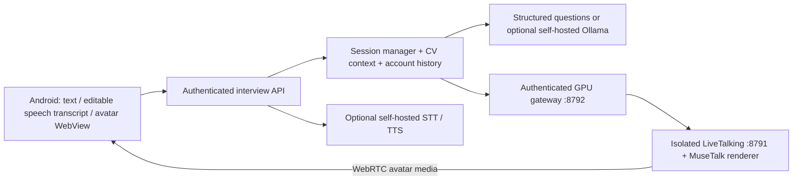

# LiveTalking / MuseTalk audit — 1 November 2026

## Audited primary sources

LiveTalking snapshot: `c7269433a2b6ecebcd9342445d2ecc882c98b0da`.
- [LICENSE](https://github.com/lipku/LiveTalking/blob/c7269433a2b6ecebcd9342445d2ecc882c98b0da/LICENSE): Apache-2.0; preserve license, notices, attribution and changes if redistributing derived code. No endorsement/trademark rights inferred.
- [README](https://github.com/lipku/LiveTalking/blob/c7269433a2b6ecebcd9342445d2ecc882c98b0da/README.md), [requirements](https://github.com/lipku/LiveTalking/blob/c7269433a2b6ecebcd9342445d2ecc882c98b0da/requirements.txt), [API](https://github.com/lipku/LiveTalking/blob/c7269433a2b6ecebcd9342445d2ecc882c98b0da/docs/api.md), [app.py](https://github.com/lipku/LiveTalking/blob/c7269433a2b6ecebcd9342445d2ecc882c98b0da/app.py), [MuseTalk avatar renderer](https://github.com/lipku/LiveTalking/blob/c7269433a2b6ecebcd9342445d2ecc882c98b0da/avatars/musetalk_avatar.py).

MuseTalk snapshot: `0a89dec45a0192b824e3cf4daf96c239440c5ed8`.
- [LICENSE](https://github.com/TMElyralab/MuseTalk/blob/0a89dec45a0192b824e3cf4daf96c239440c5ed8/LICENSE): MIT for project code, with separate third-party notices (including Whisper/face parsing MIT, other components Apache-2.0). Retain original notices if redistributed.
- [README](https://github.com/TMElyralab/MuseTalk/blob/0a89dec45a0192b824e3cf4daf96c239440c5ed8/README.md), [requirements](https://github.com/TMElyralab/MuseTalk/blob/0a89dec45a0192b824e3cf4daf96c239440c5ed8/requirements.txt).
- Authors describe their own trained model as commercially usable, but explicitly restrict their Internet test data to non-commercial research. That statement is not a license for faces, all weights, datasets, or downstream components. Verify each weight/model license separately. No upstream test face or sample video is included in KarirMate.

No upstream code or model is vendored. The new gateway speaks the documented API and checks a locally approved avatar manifest. An original synthetic avatar or a consenting actor with commercial interview rights is required; an empty example manifest is intentionally unapproved. No real person is imitated. Avatar source SHA-256, rights holder and release reference must match before the worker reports a licensed avatar.

## Compatibility and hardware

| Component | Upstream documented environment | Implication |
|---|---|---|
| Current LiveTalking | Ubuntu 22.04, Python 3.12, PyTorch 2.9.1, CUDA 12.8; recommends RTX 3080 Ti or higher for MuseTalk | Use a separately pinned/tested GPU environment, not Termux |
| Standalone MuseTalk | Python 3.10, torch 2.0.1; CUDA 11.7 recommendation / cu118 installation instructions; diffusers 0.30.2, transformers 4.39.2, MMLab stack, FFmpeg | Do not combine both requirements files in the main backend venv |
| KarirMate gateway | Python standard HTTP server + requests; delegates rendering | Has no torch import until health probe and no auto-download/startup |

The integration target is LiveTalking's MuseTalk renderer behind an isolated worker. Standalone MuseTalk is not itself a WebRTC server. Avatar preprocessing, Whisper/VAE/face parsing/UNet weights and prepared frame/latent/mask assets are still required. The gateway checks CUDA, renderer/UNet, approved source and prepared coordinate artifacts plus upstream HTTP availability. This is a readiness guard, not proof of sustained lip-sync or realtime performance: only a real SDP/media test can establish that. No VRAM/latency guarantee is inferred from upstream benchmark numbers.

No NVIDIA device, torch, weights, voice services, approved avatar or Ollama model was available in this execution environment. FFmpeg alone does not enable avatar rendering. No GPU worker was started and no model downloaded.

## Implemented architecture

GPU worker must be on another Linux host. Existing services on 8787, 8788 and 8789 are rejected by adapter and worker configuration; no existing port, service, Hermes or Reels automation is touched. Default gateway binds loopback, requires a worker-only bearer key stored outside Git, and should be reached through an operator-managed private tunnel/reverse proxy after deployment review. Do not expose bare LiveTalking unauthenticated.

`/offer`: forwards only SDP/type and approved avatar ID; the returned actual session ID is private to the backend. `/human`: permits `type=echo` only, with the backend's current question. Client cannot override LLM/provider keys through this proxy. Android receives video/audio only; no candidate camera is requested. Subtitles use the actual question. Answers/transcripts go through the authenticated session API, not an untrusted avatar chat endpoint.

ICE defaults to an empty server list. Production mobile NAT generally needs reviewed STUN/TURN configuration and credentials, forwarded through the worker health contract as `ice_servers`; no paid TURN service is added. No traversal or real Android media test was possible. A changed network may require reopening the video session; reconnection/worker-session lifecycle and production rate limiting still need hardware validation and operational work. The proxy guards inputs and credentials but is not a complete deployment perimeter.

Use a compatible self-hosted LiveTalking TTS backend and licensed bilingual voices. Do not silently use its cloud/provider defaults. Upstream dependencies, model paths, TTS driver and CUDA compatibility must be verified in the isolated GPU environment before enabling the video capability.

## Verification boundary

- IMPLEMENTED: protocol adapters, session ownership/revision/idempotency, PRO checks, authenticated proxy, approved-avatar checks, text/subtitle fallback and Android WebRTC bridge.
- TESTED WITH MOCK: Ollama, STT, TTS, worker health, SDP offer/echo shape, proxy authentication and no-GPU fallback.
- TESTED WITH REAL SERVICE: public upstream documentation/source retrieval only; no real model, voice or avatar service.
- NOT TESTED: physical Android microphone/TTS/WebView, actual ICE/TURN, rendered media, lip sync, latency, concurrent GPU sessions.
- BLOCKED: licensed avatar, model/voice weights, GPU host and renderer services have not been supplied. Video is not declared working in realtime. This remains a development integration, not a production activation.
